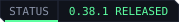
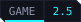
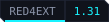

<p align="center">
  
</p>

<p align="center">
  <a href="https://edgemodders.github.io/REDnode/"></a>
  
  
  
  
  <a href="LICENSE"></a>
</p>

A Node.js API for scripting Cyberpunk 2077 (PC, single-player).

REDnode attaches to the game through RED4ext and exposes the game's reflection (RTTI) system to TypeScript and JavaScript. Mods are Node packages that run beside the game; overlay apps are web pages drawn over it; both use the `rednode` package, which can call any game function, typed from the game's own data.

**[Read the docs](https://edgemodders.github.io/REDnode/)** &middot; [API reference](https://edgemodders.github.io/REDnode/api/) &middot; [Design](https://edgemodders.github.io/REDnode/design.html)

> [!NOTE]
> **Status: 0.37.0 released on 2026-10-24, for game 2.31 only** (the next release moves to 2.5). Download it from [Nexus Mods](https://www.nexusmods.com/cyberpunk2077/mods/35419) or [GitHub releases](https://github.com/Edgemodders/REDnode/releases). Optional packs: [Admin Tools](https://www.nexusmods.com/cyberpunk2077/mods/35793) and Sound Tools (on the GitHub release). The in-game assistant [REDagent](https://www.nexusmods.com/cyberpunk2077/mods/35670) runs on it. The current work and the roadmap are on the [docs home page](https://edgemodders.github.io/REDnode/).

## How it works

REDnode has two tiers.

| | Tier 2: async mods | Tier 1: interceptors |
|---|---|---|
| Runs in | A separate Node process | The game process, sandboxed |
| Can | Observe events, query state, send commands | Change arguments or return values inside a hook |
| Cannot | Block the game | `await`, do I/O, run long |
| Language | TypeScript / JavaScript with npm | Restricted JavaScript (QuickJS), compiled from TypeScript |

A thin native RED4ext plugin bridges the two. It exposes the game's RTTI over IPC and queues all game access onto the game thread.

```
 Game process                          Node process
 ┌──────────────────────────┐          ┌──────────────────────┐
 │ game thread + hooks      │          │ Tier 2 mods          │
 │ Tier 1 interceptors      │  pipe    │ rednode SDK          │
 │ native plugin (RED4ext)  │◄────────►│ hot reload, tooling  │
 └──────────────────────────┘          └──────────────────────┘
```

Simple synchronous behavior ("multiply incoming damage by 0.5") can also be declared as a native rule that needs no JS engine at all.

## What REDnode is made of

| Part | What it does | In the repo | In the game folder |
|---|---|---|---|
| **Plugin** (`REDnode.dll`) | Runs inside the game, loaded by RED4ext: draws the overlay windows on the game's frame, takes input (F10), runs game calls on the game thread (the generic game API), sends game events, and starts the host | `native/` | `red4ext/plugins/REDnode/REDnode.dll` |
| **Plugin scripts** | Small redscript parts: the game events REDnode sends, and the world support, which compiles only when Codeware is installed | `native/scripts/` | `red4ext/plugins/REDnode/Scripts/` |
| **Overlay host** | An Electron app beside the game: renders overlay apps, runs Node mods in their processes, the kernel MCP server, the agent broker, hot reload, settings | `packages/overlay/` | `red4ext/plugins/REDnode/host/` |
| **Built-in apps** | The launcher, the Mod log and the Mod Manager, inside the host | `packages/overlay/launcher/`, `modlog/`, `manager/` | Inside the host |
| **`rednode` package** | The API mods and apps import: `game`, `api` (typed from the game's own data), `ui`, `world`, `agent`, `pkg`, `secrets`, `kernel`, `channel` | `packages/rednode/` | `host/resources/sdk/` |
| **UI kit** | Web components and themes for overlay apps | `packages/ui/` | Inside the host, served as `rednode://ui/` |
| **Sample packages** | Example apps and mods (Hello mod, Ask mod, World test, Test timer...). Each has its own version | `packages/overlay/apps/` | `red4ext/plugins/REDnode/apps/` |

**Versions.** REDnode has one version, shared by every part above except the samples. It is in `VERSION` at the root of the repo: the plugin's build reads it, and `node tools/version.mjs <version>` copies it into the host, the package, the UI kit and the built-in apps. `tools/build-native.ps1` stops if any part differs. The plugin's log says `REDnode <version> loading`, the host's log `REDnode overlay host <version>`, and the launcher shows it. Releases will ship the parts together as one REDnode bundle.

Also in the repo: `docs/` (the docs site), `gameapi/` (the game's type signatures for the typed API and the game API reference), and `tools/` (build, deploy, packaging and version scripts).

## Roadmap

The full table, with each phase's status and test results, is on the [docs home page](https://edgemodders.github.io/REDnode/).

- **P0 Research, P1 Proof:** done.
- **HTML overlay (O1 to O9):** O1 to O6 and O8 passed in game. O7 Display and O9 Debugger are planned.
- **World API (W1, W2):** placing things in the world, for EDGEbuilder. W1 passed in game.
- **P2 Tier 2:** mostly done through the overlay host. **P3 Rules** and **P4 Tier 1** (sync interceptors in the game) are not started.

## Compatibility goals

REDnode should coexist with Cyber Engine Tweaks, RED4ext plugins, redscript and REDmod. It will use RED4ext's hooking and the Address Library instead of hard-coded offsets, so mods survive game patches.

## Legal

Single-player modding only. This repository contains no game files and no data extracted from them. Check CD Projekt's modding terms before distributing anything built with it.

## License

[MIT](LICENSE)
