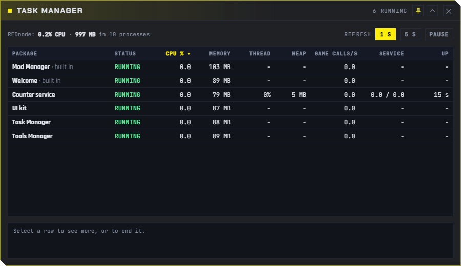
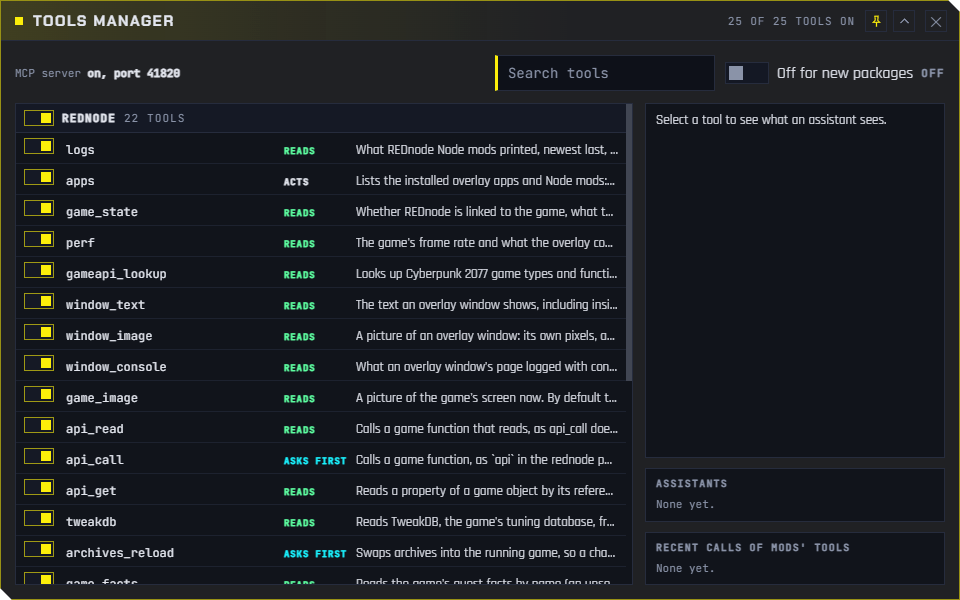

# Admin Tools

**REDnode Admin Tools** is an optional app pack for players and modders who want to manage REDnode itself: see what every mod costs, stop one that misbehaves, and decide which tools AI assistants may use. It is its own download, beside REDnode, and its source lives in this repo at [`packs/admin-tools/`](https://github.com/Edgemodders/REDnode/tree/main/packs/admin-tools).

| App | What it does |
|---|---|
| [Task Manager](#task-manager) | Every running package with its CPU, memory, thread load, heap, game calls and service calls. **End task** and **Restart** |
| [Tools Manager](#tools-manager) | Every tool an AI assistant sees through REDnode, REDnode's own and each mod's, with a switch for each |

Both were built into REDnode 0.34.0 to 0.36.0. From REDnode 0.37.0 they are in this pack, so a player who never needs them does not see them, and so other modders can write admin apps of their own with the same [`admin` permission](#the-admin-permission).

## Install

| Needs | Why |
|---|---|
| [REDnode](https://github.com/Edgemodders/REDnode/releases/latest) 0.37.0 or later | The pack's apps ask for it, so the Mod Manager says so when REDnode is too old |
| Game version 2.31 | As REDnode |

1. Install the zip with Vortex, or extract it into the game folder: the two apps land in `red4ext/plugins/REDnode/apps/` (`taskmanager`, `toolsmanager`).
2. In the game, press **F10** and open the **Mod Manager** from the launcher. Select **Task Manager**. Under **Permissions**, read the warning and switch **Allowed** on for both: **managing REDnode** (the `admin` permission) and **staying above other packages' windows** (`front`).
3. Switch it **Open**, and press **Pin to launcher** to keep it one press away. Do the same for **Tools Manager**.

Until its permission is allowed, each window opens but says so in its details pane: "Task Manager needs the admin permission: allow it in the Mod Manager".

To uninstall, remove it in your mod manager or delete those two folders. REDnode stays, and so do the tool switches you set (see [Tools Manager](#tools-manager)).

## Task Manager



Every running package, refreshed every second or five (**1 s**, **5 s**, **Pause**). Click a column to sort by it.

| Column | Shows |
|---|---|
| **Status** | Running, starting, crashed, not responding, ended |
| **CPU %**, **Memory** | The package's Node mod process and its windows. A mod in the shared process shows the whole process, since Windows sees no finer |
| **Thread**, **Heap** | The mod's own thread: how busy its event loop is (100 % means stuck or very busy) and its JavaScript memory. These tell mods in the shared process apart |
| **Game calls/s** | Calls into the game a second, with their round trip |
| **Service** | [Service calls](overlay-apps.md#calling-other-packages) a second, to it and from it |
| **Up** | How long it has run |

Select a row for its details, then:

| Button | Does |
|---|---|
| **End task** | Stops the package now, even a mod stuck in an endless loop: one that does not stop within 2 s has its process ended. A mod in the shared process is stopped alone; the others in it run on. Its windows close. It stays switched on, so the next start of the game brings it back |
| **Restart** | Starts it again now, with its window if it had one open |

REDnode's own windows (the Mod Manager, the Mod log) are listed but cannot be ended.

## Tools Manager



Every tool an AI assistant can see through [REDnode's MCP server](mcp.md), as Claude Code and REDagent see it: REDnode's own (`api_read`, `api_call`, `archives_reload`, ...), then each running mod's tools (the functions its [service file](overlay-apps.md#describing-a-service) marks `@tool`). Each row says what the tool does and whether it **reads** (runs without asking), **asks first** or **acts**.

| Control | Does |
|---|---|
| The switch on a tool | Takes it away from every assistant, from its next request. `mod_call` refuses it too |
| The switch on a group | The same for all of REDnode's tools, or all of one mod's |
| **Off for new packages** | A newly installed mod's tools start switched off, until you switch them on |
| Select a tool | Its description and parameters, as an assistant reads them |
| **Assistants** | Which assistants have connected, by the name they give (Claude Code says `claude-code`), and when |
| **Recent calls of mods' tools** | The newest calls: when, by which assistant, the result or error |

Switching off `api_read` or `api_call` takes the game API away from every assistant, REDagent included; the window says so beside them.

The switches are kept by REDnode, not by the pack, across starts. If you remove the pack, the tools you switched off stay off; install the pack again to change them.

## The `admin` permission

The two apps ask for `admin`, a permission any package can ask for in its `rednode-app.json`:

```json
{ "permissions": ["admin"] }
```

The Mod Manager shows it with a warning in red: *Allow this only for a package you trust: it can end or restart any of your mods, and switch on AI tools you switched off.* Withdraw it there at any time; the next call is refused.

With it, an overlay page uses `admin` from the `rednode` package:

| Call | Answers |
|---|---|
| `admin.tasks()` | Every running package with what it costs: the Task Manager's table |
| `admin.endTask(id)`, `admin.restartTask(id)` | End task and Restart |
| `admin.tools()` | Every tool, grouped, with the switches, the assistants and recent calls |
| `admin.setTool(what, id, on)` | A switch: `"tool"` with a tool's key (`counter-service:reset`, `rednode:api_call`), `"group"` with a package id or `"rednode"`, or `"new-off"` |

```js
import { admin } from 'rednode';

// End any mod that stops answering.
setInterval(async () => {
  const { rows } = await admin.tasks();
  for (const r of rows) if (r.mod?.status === 'not-responding') await admin.endTask(r.id);
}, 5000);
```

`admin` works in overlay pages only. The types (`TaskRow`, `ToolList` and the rest) are in the [API reference](api/). The Task Manager's and Tools Manager's own code is in [Example apps](examples/).

## Admin Tools test

Before: REDnode 0.37.0 deployed, and the Admin Tools draft zip (`REDnode-Admin-Tools-0.1.0-draft.zip`) extracted into the game folder. The Task Manager and Tools Manager are no longer in REDnode itself. Load a save.

0. Switch on **Test timer** in the launcher, press **Start**, and press **Mark** after each step.
1. **F10**: the launcher no longer lists Task Manager and Tools Manager as built in. Open the **Mod Manager** and search "manager": **Task Manager** and **Tools Manager** are listed, version 0.1.0, author Edgemodders. **Mark**.
2. Select **Task Manager**. Under **Permissions**: "Asks for managing REDnode: ..." with the red warning under it, and "Asks for staying above other packages' windows". Leave both off. Switch it **Open**: its window opens, and after a second its details pane says "Task Manager needs the admin permission: allow it in the Mod Manager". **Mark**.
3. In the Mod Manager, switch **Allowed** on for both of the Task Manager's permissions: within a second its table fills with the running packages. **Mark**.
4. Switch on **Crash mod**, press its **Hang forever**. In the Task Manager, its Thread reads about 100 %. Select it and press **End task**: it stops. Press **Restart**: it runs again. **Mark**.
5. Mod Manager: select **Tools Manager**, allow both permissions, and switch it **Open**: its list shows REDnode's tools. Switch on **Counter service**: its three tools appear. Switch `counter_service__reset` off, then on again. **Mark**.
6. In the Mod Manager, withdraw the Task Manager's **admin** permission: its details pane says it needs the permission again. **Mark**.
7. Press **Pin to launcher** for both managers: they show in the launcher. **Mark**.
8. Quit the game. Send `rednode-overlay.log` and `rednode-mods.log`.

### Admin Tools test: results

2026-10-24, REDnode 0.37.0 with the pack's draft zip, the 2.31 backup folder: **pass**, every step. The player: everything worked.

| Step | Seen in the logs |
|---|---|
| 1 | Both managers found as packages (42 apps); they opened at start, as the player had left them open when they were built in, and were closed for the test |
| 2 | The Task Manager opened without its permissions (its pane said why) |
| 3 | "Granted admin for taskmanager", "Granted front for taskmanager"; the table filled |
| 4 | Crash mod hung, then "End task: crash-mod, by Task Manager", stopped in the same second. **Restart** was tried on Counter panel: "End task: counter-panel, by Task Manager", then "Restarted by Task Manager" 2 s later, connected to Counter service again |
| 5 | The Tools Manager granted and opened; "Tools: tool counter-service:reset off, by Tools Manager", then on |
| 6 | Each manager's admin permission withdrawn and allowed again ("Withdrew admin for toolsmanager", "Withdrew admin for taskmanager") |
| 7 | "Pinned taskmanager to the launcher", "Pinned toolsmanager to the launcher" |

Found: a manager opened before its permission is allowed asks the host every second and is refused each time. Nothing of it reaches REDnode's logs; it is quiet once allowed.

