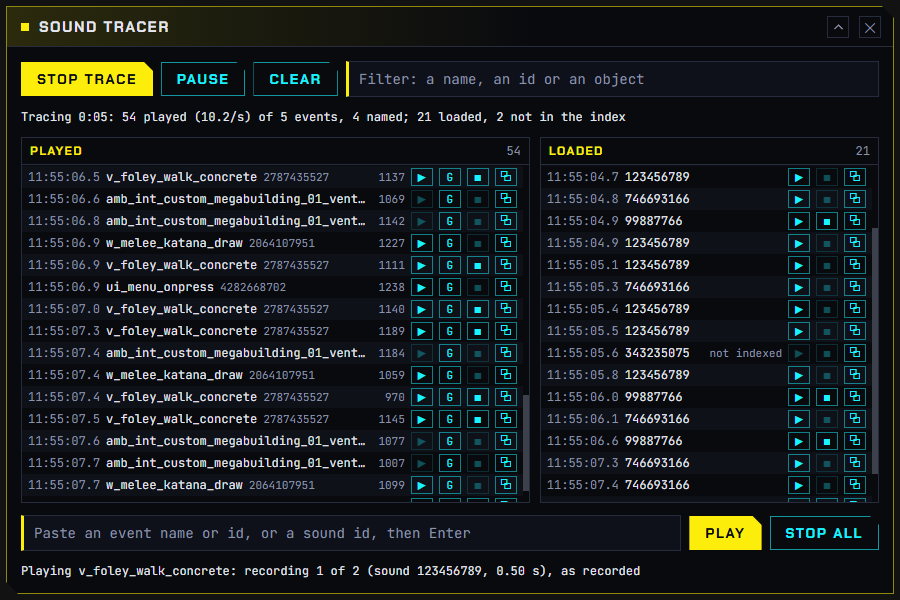
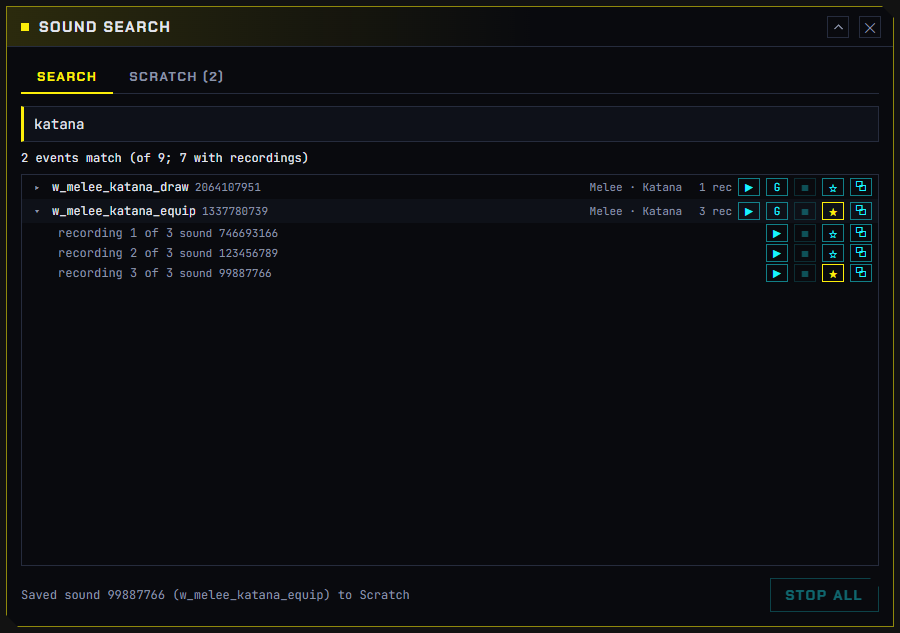
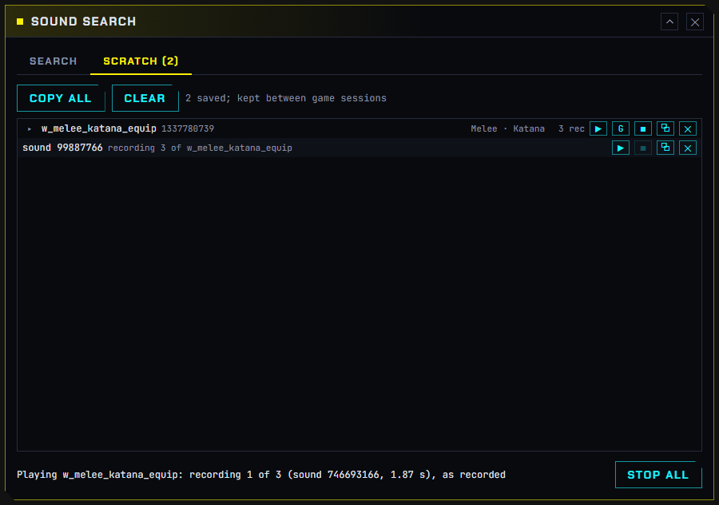
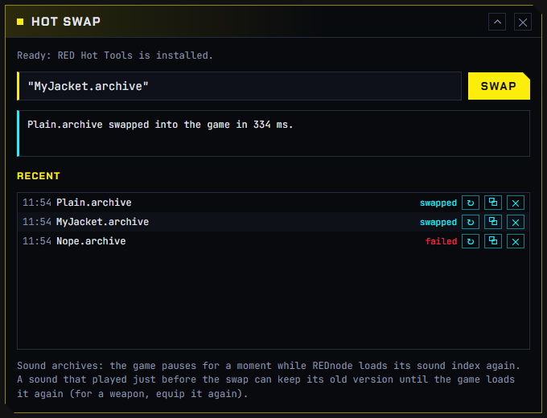

# Sound Tools

**REDnode Sound Tools** is an optional app pack for sound modders: three windows over the game that show every sound Cyberpunk 2077 plays as it plays it, search all of its sound events, play any recording on the spot, and swap a sound mod into the running game without a restart. It is its own download, beside REDnode, and its source lives in this repo at [`packs/sound-tools/`](https://github.com/Edgemodders/REDnode/tree/main/packs/sound-tools).

| App | What it does |
|---|---|
| [Sound Tracer](#sound-tracer) | Every sound event the game posts, and every sound it loads, live |
| [Sound Search](#sound-search) | The game's sound events, over 23,000, by name, tag or id, with a Scratch tab |
| [Hot swap](#hot-swap) | An archive into the running game, sound mods included |

The pictures below are the apps running in the docs' simulation; pictures from the game follow.

## Install

| Needs | Why |
|---|---|
| [REDnode](https://github.com/Edgemodders/REDnode/releases/latest) 0.41.0 or later (pack 0.1.1; pack 0.1.0 needs 0.26.15) | Everything runs on it. Each app's manifest asks for it, so the Mod Manager says so when REDnode is too old |
| Nothing more for Hot swap | It swaps through [REDswap](redswap.md), which REDnode 0.41.0 installs. Pack 0.1.0 needed [RED Hot Tools](https://github.com/psiberx/cp2077-red-hot-tools/releases) 1.3 or later |
| REDbridge (optional) | Event names. Without it, events show as ids. The Mod Manager's **Get REDbridge** button installs it, with no admin rights |
| Game version 2.5 (pack 0.1.1) or 2.31 (pack 0.1.0 with REDnode 0.37.0) | Sound swaps need REDnode to know the game version's sound tables; on another version they are refused. On 2.5, Sound Search, Sound Tracer and Hot swap passed a check on 2026-10-27; sound swaps are untested there so far |

1. Install the zip with Vortex, or extract it into the game folder: the three apps land in `red4ext/plugins/REDnode/apps/` (`sound-tracer`, `sound-search`, `hot-swap`).
2. In the game, press **F10** and open the **Mod Manager** from the launcher. Switch on the apps you want; they start off.
3. Hot swap asks to change the game's archives (the `archives` permission): allow it in the Mod Manager.

To uninstall, remove it in your mod manager or delete those three folders. REDnode stays.

## Sound Tracer

> **Picture from the game to come:** the Tracer over the game while V draws a katana.

Press **Start trace** and play.

| Column | Shows | Buttons on each row |
|---|---|---|
| **Played** | Every event the game posts to its audio engine (Wwise): the time, the name where REDbridge's list has it (else `#` and the id), the id, and the game object it plays on | **▶** plays the event's own recordings in turn, raw, heard wherever the sound is in the game (greyed when it has none: a stop event, or one whose sound lives in a Wwise bank). **G** posts the event through the game on V, with the game's own mix. Stop, Copy |
| **Loaded** | Every sound the game loads, by sound id (`not indexed` when the game's opus index does not have it) | **▶** plays that recording. Stop, Copy |

Also: a filter over both columns, **Pause** (new rows wait and come in on **Resume**), **Clear**, a box that plays a pasted event name, event id or sound id, and **Stop all**. Each column keeps its newest 2,000 rows and follows the newest unless you scroll up; the host writes every row to `red4ext/logs/rednode-sound-trace.log`, so nothing is lost. Closing the window stops the trace and anything it was playing.

Good to know: the first trace of a session takes a fraction of a second to start, while REDnode finds the game's sound tables. Many posted events cannot play on their own through the game (a footstep needs the ground under the NPC that made it); **▶** plays their recordings instead.

## Sound Search

> **Picture from the game to come:** Sound Search over the game with results for a footstep search.

Type and the results come as you type:

| You type | It finds |
|---|---|
| Words, like `fs concrete walk` | Events whose name or tags hold every word, in any order. Names that start with the first word come first |
| An event id, like `1337780739` | That event |
| A sound id, like `746693166` | The events that play that recording, opened with it marked |

Each result shows the event's name, id, tags and how many recordings it has. **▶** plays its recordings in turn; **▸** lists them, each playable on its own; **G** posts the event through the game. Names arrive a few seconds after the first search while REDbridge starts: until then the window says so, matches ids only, and searches again by itself.

**☆** saves an event or a single recording to the **Scratch** tab, which is kept between game sessions (in the window's own storage). **Copy all** puts the list on the clipboard; **✕** takes one out.

## Hot swap

> **Picture from the game to come:** Hot swap after swapping a sound archive.

Type an archive's name (one in `archive/pc/mod`) or its full path, and press **Swap** or Enter. A path from Windows' **Copy as path**, quotes and all, works. REDswap swaps it in (RED Hot Tools with pack 0.1.0); the answer says what was swapped, how long it took, and why anything was not.

For a sound archive (one with the game's `.opuspak` or `.opusinfo`), REDnode pauses the game for a moment, holds its audio, has the archive swapped, loads the game's sound index again and lets the audio go, so the new sounds play without a restart. A sound that played just before the swap can keep its old version until the game loads it again: for a weapon, equip it again.

**Recent** keeps your last 30 swaps, newest first, between sessions: **↻** swaps one again, so after your next build it is one press.

## A sound modding loop

1. **Trace**: do the thing in the game (draw the katana) and read its event in the Tracer.
2. **Search**: open that event in Sound Search, play its recordings and find the one to change. Save it to Scratch.
3. **Make** your version, for example with [EDGEwave](https://github.com/Edgemodders/EDGEwave), and pack it as an archive.
4. **Hot swap** it in, and hear it in the game without leaving it. Change it, build it, press ↻.

## For mod makers

Everything the apps do is in the `rednode` package, for your own mods. All experimental: their shape may change.

| Call | Does |
|---|---|
| `audio.trace(onTrace)` | The live list: batches of posted events (with names where known, and how many recordings each has) and loaded sounds, about ten a second |
| `audio.playGame(soundId)`, `audio.playGame({ event, variation? })` | Plays a recording, or an event's recordings, through REDnode's engine |
| `audio.eventSounds(event)` | An event's recordings (sound ids) |
| `audio.searchSounds(query, { limit })` | The search behind Sound Search |
| `audio.event(name, { on })` | Posts an event through the game, on V or with no entity; `stop()` on what it returns |
| `archives.reload(files)` | The swap behind Hot swap; needs the `archives` permission |

How it works under the hood, and how it was tested in the game: [Sound API](sound.html#sound-tools-sp1-to-sp4) and [World API](world.html) (hot-loading archives).

## Building the pack

For maintainers. The pack is outside REDnode's build: `npm run overlay:package` and REDnode's player zip leave it out.

| File | What |
|---|---|
| `packs/sound-tools/pack.json` | Its name, version, apps and the REDnode it needs (each app's manifest must ask for the same in `requires`) |
| `packs/sound-tools/changelog.md` | Its own changelog, kept like REDnode's |
| `packs/sound-tools/apps/` | The three apps |
| `packs/sound-tools/nexus/` | Its Nexus page: description, brand images, form fields |

`npm run release:pack` builds `native/build/release/REDnode-Sound-Tools-<version>.zip`. It checks every app against `pack.json` and stops if the changelog has no section for the version; `npm run release:pack -- --draft` builds a test zip without that check.
